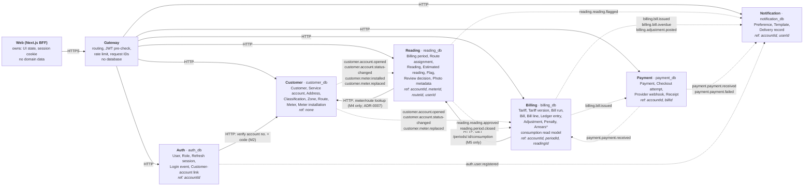

# Architecture

> **Status:** M0 draft for **Checkpoint A**. Nothing here is built yet. This document fixes the service boundaries that M1 onwards build against. Boundary changes after Checkpoint A need an ADR.

Sources: Roadmap §2.3 (target architecture), Appendix C (event catalog). Development Plan › Target Architecture (ownership matrix, sync/async boundaries).

## 1. Context map

Solid arrows are synchronous HTTP. Dotted arrows are asynchronous domain events through RabbitMQ (from M7). Each box lists the entities the service **owns**. *ref:* lists what it only holds as an ID. Mermaid source: [diagrams/context-map.mmd](diagrams/context-map.mmd).

\* *Arrears* is not stored. It is a figure computed from the ledger when a bill is produced.

## 2. Every §3.1 entity has exactly one owner

This is the Checkpoint A definition-of-done check.

| Entity (Roadmap §3.1) | Owning service | Others hold | Why here |
|---|---|---|---|
| Customer | **Customer** | `customerId` | The party who pays. Master data. |
| Service account | **Customer** | `accountId`, `accountNo`, classification in events | Master data. Lifecycle rules are given for M1. |
| Classification | **Customer** (account attribute) | Billing receives it in `customer.account.opened` | Classification describes the account. Billing owns the *prices* per classification. |
| Meter | **Customer** | `meterId`, serial, max digits in events | Inventory, install and replace are customer-service operations in M1. |
| Zone / route | **Customer** | `zoneId`, `routeId` | The geographic grouping of addresses. See decision D-1 below. |
| Billing period | **Reading** | `periodId` | Reading windows drive validation (R4) and period close. Billing reacts to `reading.period.closed`. |
| Reading | **Reading** | `readingId` (bill traceability) | The core of the reading context. |
| Estimated reading | **Reading** | `estimated: true` in `reading.reading.approved` | Produced by R6 and period close. |
| Tariff | **Billing** | – | Prices are billing data, versioned by effective date. |
| Bill | **Billing** | `billId`, `billNo`, amounts in events | Immutable billing document. |
| Ledger | **Billing** | – | The source of truth for balance. Payment never writes it; it publishes `payment.received`. |
| Arrears | **Billing** (derived from ledger) | – | Not a stored field. |
| Penalty | **Billing** | amount in `billing.bill.overdue` | A ledger debit applied by a billing job. |
| Rollover | **Reading** (detection) | Customer holds `maxDigits` on the meter | Detection happens when computing consumption. The meter's max digits are meter master data. |

Entities beyond §3.1:

| Entity | Owner |
|---|---|
| User, role, refresh session, login event, customer-account link | Auth |
| Meter installation (history) | Customer |
| Route assignment (reader ↔ route ↔ period) | Reading |
| Flag, review decision, photo metadata | Reading |
| Bill run, bill line, adjustment, consumption read model | Billing |
| Payment, checkout attempt, provider webhook, receipt | Payment |
| Notification preference, template, delivery record | Notification |

## 3. Boundary decisions made in M0

These are proposals. They are recorded in [assumptions.md](assumptions.md) and need sign-off at Checkpoint A.

**D-1 Routes vs. route assignments.** **Customer** owns zones and **routes**: which addresses are on which route, and in what walking order. That is stable geographic master data. **Reading** owns **route assignments**: which reader reads which route in which period. That is operational data, and the Dev Plan says it is "the source of truth for reader authorization". *Conflict found:* the Dev Plan's DB inventory also lists `route_assignments` under `customer_db`. We treat that as a defect and keep assignments only in `reading_db` (as `reading_assignments`).

**D-2 Owner of the "previous reading".** **Reading** owns it. Consumption is a reading concept: it needs the last approved or estimated reading, rollover detection and replacement maths, all of which live in Reading. Customer contributes only the *initial* and *final* readings captured at install and replace time, and publishes them in `customer.meter.installed` and `customer.meter.replaced`. Reading stores them as the start and end points of each installation segment. Billing never computes consumption; it receives it.

**D-3 How Reading gets meter and account data.** M4 starts with a synchronous call to Customer, as the Dev Plan specifies. M7 moves to a local read model fed by `customer.*` events. ADR-0007 decides this formally in M4 and is revisited in M7. This is a likely candidate for the "decision later reversed" (ADR-0020).

**D-4 Customer-account link.** Proposed owner: **Auth** (`customer_account_links` in `auth_db`, as the Dev Plan lists). Auth verifies the account number and code with Customer at registration. ADR-0005 decides this in M2.

**D-5 Who triggers the bill run.** Billing pulls consumption from Reading over HTTP in M5. From M7 it builds its own consumption read model from `reading.reading.approved` and starts on `reading.period.closed`.

## 4. Synchronous vs. asynchronous (Dev Plan)

| Interaction | Mechanism | Reason |
|---|---|---|
| Browser → Web | HTTPS | Secure BFF/session boundary |
| Web → Gateway | HTTPS | Single public API entry point |
| Gateway → services | HTTP | Request/response operations |
| Token verification | Local JWT/JWKS check | No call to Auth per request |
| Auth → Customer | HTTP (registration only) | One-off verification |
| Reading → Customer | HTTP first, read model later | ADR-0007; revisited in M7 |
| Reading → Billing | Events | Billing builds its own consumption read model |
| Billing → Payment | Events (API where needed) | Payment state is asynchronous and idempotent |
| Billing → Notification | Events | `bill.issued` and related |
| Payment → Billing | `payment.received` event | Ledger credit must be idempotent |
| All publishing | Transactional outbox | No lost events |
| All consuming | Inbox / processed-event table | No duplicate side effects |

## 5. Rules every service follows

- Each service owns its database. **No service reads another service's tables**, not even "just this once".
- Shared packages hold **tooling and contracts only** (logger, auth middleware, event schemas). No shared domain classes or DB models.
- The gateway holds no business logic.
- Money is integer **minor units** with a currency code. No floats.
- Issued bills are immutable. Corrections are adjustments.
- Every retryable external mutation has an idempotency strategy.
- The backend enforces authorization. The UI hiding a button is not security.
- Containers run as non-root and expose `/healthz` and `/readyz`.

## 6. The life of a bill (Roadmap §2.4)

1. **Read:** a reader submits a reading and photo. *Reading*
2. **Validate:** rules R1–R7 flag anomalies. *Reading*
3. **Approve:** an officer reviews flagged reads. *Reading*
4. **Bill run:** the tariff is applied and draft bills are made. *Billing*
5. **Issue:** the PDF is stored and the ledger is debited. *Billing*
6. **Notify:** an email or SMS goes to the customer. *Notification*
7. **Pay:** a payment event credits the ledger. *Payment → Billing*

From step 4 onward everything is triggered by events, not direct calls, once M7 is complete.
